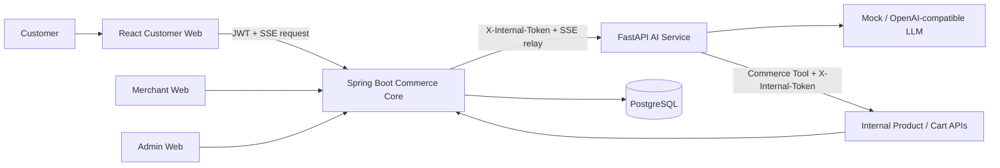
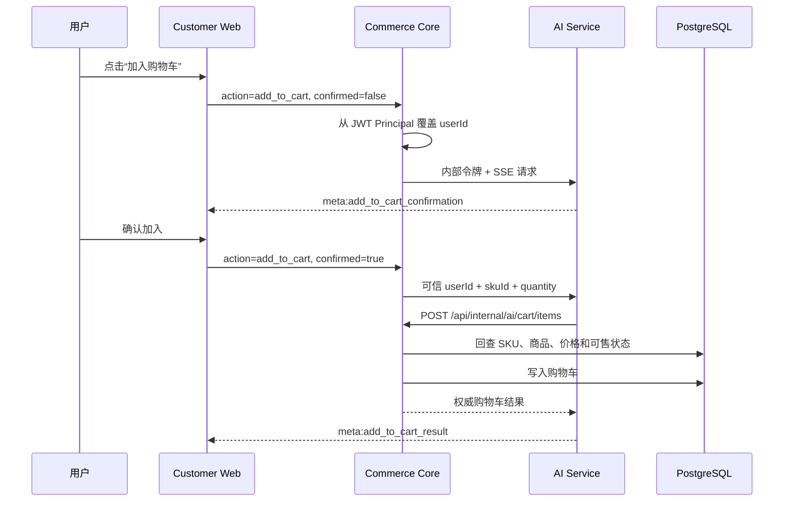

# AI Commerce Platform

一个面向 AI 应用开发岗位的智能电商项目：使用 **Spring Boot Commerce Core** 维护商品、价格、库存与购物车等权威业务数据，使用 **FastAPI AI Service** 完成自然语言意图解析、LLM 流式生成和业务工具编排，并通过 **React Customer Web** 提供“自然语言找商品 → 显式确认 → 真实加入购物车”的完整闭环。

> 这个项目的重点不是给电商页面增加一个聊天框，而是验证 AI 如何在身份可信、数据可信、写操作可控的前提下接入真实业务系统。

## 核心演示

1. 用户登录 Customer Web，输入“帮我找 500 到 1000 元的耳机”。
2. AI Service 解析关键词和价格区间，通过受保护的 Commerce Tool 查询真实商品库。
3. 前端在 SSE 对话流中渲染商品卡片和可用 SKU。
4. 用户点击“加入购物车”后，系统只返回确认事件，不立即执行写操作。
5. 用户再次确认后，AI Service 调用 Commerce Core 内部接口完成加购。
6. Commerce Core 根据 JWT 身份和 SKU 主键重新读取商品名称、价格、图片与可售状态，拒绝客户端或模型伪造业务字段。

## 系统架构



### AI 加购时序



## 已实现能力

### AI 应用链路

- 支持基于 SSE 的逐 Token 流式响应，并透传 `message`、`meta`、`error`、`done` 事件。
- 支持中文商品搜索意图解析，包括关键词、价格区间、分类和分页条件。
- 支持 AI Service 通过 Commerce Tool 查询真实商品数据，而不是把商品信息硬编码在 Prompt 中。
- 支持“请求加购 → 用户确认 → 执行工具 → 返回结果”的两阶段写操作。
- 支持 Mock Provider 和 OpenAI-compatible Provider，便于本地无 Key 演示及切换 DeepSeek/OpenAI 兼容服务。

### 工程与安全边界

- Customer Web 只访问 Commerce Core，不直接暴露 AI Service 内部接口。
- Commerce Core 从 JWT `Principal` 获取用户身份，并覆盖请求体中的 `user_id`。
- 服务间接口统一使用 `X-Internal-Token` 鉴权。
- 加购接口只接受 `userId + skuId + quantity`；价格、名称、图片均由 Commerce Core 回查。
- 写操作必须经过显式确认，避免模型或误触直接修改用户数据。
- 商品不存在、SKU 下架、参数非法、上游不可用等失败均转换为可解释事件。

### 电商业务底座

- Customer、Merchant、Admin 三套 React 客户端。
- 商品 SPU/SKU、类目、购物车、订单、支付、退款、库存、履约和仓储等业务模块。
- PostgreSQL + Flyway 数据库版本管理。
- GitHub Actions 持续验证 Java、Python 和三套前端项目。

## 技术栈

| 层级 | 技术 |
|------|------|
| Customer / Merchant / Admin Web | React 19、TypeScript、Vite、Ant Design、Zustand |
| Commerce Core | Java 21、Spring Boot 3、Spring Security、Spring Data JPA、Flyway |
| AI Service | Python 3.12、FastAPI、Pydantic、HTTPX |
| LLM 接入 | Mock Provider、OpenAI-compatible API、SSE |
| 数据与工程 | PostgreSQL 16、Maven、Pytest、JUnit 5、GitHub Actions |

## 目录结构

```text
AI_Commerce_Platform/
├── ai-service/                    # LLM、意图解析、SSE、Commerce Tool
├── backend/commerce-platform/     # 交易真相源与内部 AI 接口
├── frontend/customer-web/         # C 端与 AI 购物助手
├── frontend/merchant-web/         # 商家后台
├── frontend/admin-web/            # 平台管理后台
└── .github/workflows/ci.yml       # Java / Python / Frontend CI
```

## 快速启动

### Docker 一键演示（推荐）

只需安装 Docker：

```bash
cp .env.compose.example .env
docker compose up --build
```

打开 `http://localhost:5173`、`http://localhost:5174` 和 `http://localhost:5175`。演示账号均为 `Demo123!`：`demo_customer`、`demo_merchant`、`demo_admin`。完整演示步骤见 `docs/demo-script.md`，彻底重置使用 `docker compose down -v`。

Compose 默认使用 Mock Provider，不需要付费模型 Key；AI Service 不暴露宿主机端口，三个前端由 Nginx 同源代理 `/api`。

### 前置环境

- JDK 21
- Maven 3.8+
- Node.js 22+
- Python 3.12+
- PostgreSQL 16

### 1. 创建数据库

```sql
CREATE DATABASE ai_commerce_platform;
```

### 2. 创建本地配置

```powershell
Copy-Item backend/commerce-platform/.env.example backend/commerce-platform/.env
Copy-Item ai-service/.env.example ai-service/.env
Copy-Item frontend/customer-web/.env.example frontend/customer-web/.env
```

Linux/macOS 可使用 `cp`。修改数据库密码，并确保两个服务使用完全相同的内部令牌：

```text
AI_INTERNAL_API_TOKEN=<shared-random-secret>
```

AI Service 模板默认启用确定性的 Mock Provider，因此首次启动不需要外部 API Key。

### 3. 启动 Commerce Core

```bash
cd backend/commerce-platform
mvn spring-boot:run
```

服务默认监听 `http://localhost:8080`，Flyway 会自动初始化和升级数据库结构。

### 4. 启动 AI Service

```bash
cd ai-service
python -m venv .venv
# Windows PowerShell: .venv\Scripts\Activate.ps1
# Linux/macOS: source .venv/bin/activate
python -m pip install -r requirements.txt
python -m uvicorn app.main:app --reload
```

服务默认监听 `http://localhost:8000`。

如需切换 DeepSeek 或其他 OpenAI-compatible 服务，在 `ai-service/.env` 中设置：

```text
AI_LLM_PROVIDER=openai-compatible
AI_LLM_BASE_URL=https://api.deepseek.com/v1
AI_LLM_API_KEY=<provider-secret>
AI_DEFAULT_MODEL=deepseek-chat
```

### 5. 启动 Customer Web

```bash
cd frontend/customer-web
npm ci
npm run dev
```

Customer Web 默认监听 `http://localhost:5173`。Merchant Web 和 Admin Web 的启动方式相同，端口分别为 `5174` 和 `5175`。

## SSE 事件约定

商品搜索结果通过元事件返回：

```text
event: meta
data: {"type":"product_search","query":{"keyword":"耳机","min_price":500,"max_price":1000,"page_size":8},"products":[...],"total":2}
```

写操作确认与执行结果使用独立事件：

```text
event: meta
data: {"type":"add_to_cart_confirmation","sku_id":42,"quantity":1}

event: meta
data: {"type":"add_to_cart_result","success":true,"sku_id":42,"quantity":1,"cart":{"items":[...]}}
```

## 验证

```bash
# Commerce Core
mvn -f backend/commerce-platform/pom.xml test

# AI Service
cd ai-service
python -m pytest

# Customer Web
cd frontend/customer-web
npm run lint
npm run build
```

CI 还会对 Merchant Web 和 Admin Web 执行 `lint` 与 `build`。

## 关键设计取舍

1. **Commerce Core 是唯一交易真相源**：LLM 只参与理解与编排，不决定价格、库存和用户身份。
2. **写操作与自然语言生成分离**：加购通过显式 `action` 路由执行，避免从任意模型文本中直接推断写操作。
3. **确认优先于自动化程度**：先保证用户可控和链路可测试，再扩展更多 Agent 工具。
4. **加购不做库存预占**：库存预占属于下单阶段，购物车阶段仅校验当前可售状态。

## 当前边界

- 当前工具编排采用服务端显式 Action 路由，并非模型原生 `tool_calls/function calling`。
- 当前商品召回以结构化意图解析和数据库过滤为主，尚未引入向量检索。
- 本地开发方式适合修改代码，完整演示优先使用 Docker Compose。
- 当前指标为单实例内存统计，Token 口径为 estimated；生产环境仍需接入集中密钥管理、持久化指标、限流熔断和分布式追踪。

## 评测与安全

- 运行 `cd ai-service && python evals/run_eval.py` 生成 60 条确定性评测报告。
- AI Service 暴露 Provider、模型、TTFT、总耗时、估算 Token 和工具成功率；管理端原样展示真实指标，不使用虚构模型数据。
- 安全边界见 `docs/security-design.md`，演示流程见 `docs/demo-script.md`。
