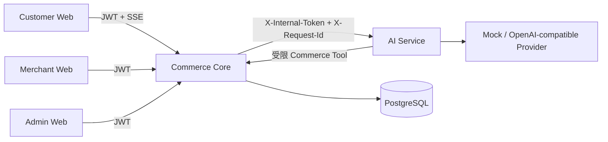

# AI Commerce Platform

一个将 LLM 安全接入真实交易系统的 AI 全栈电商平台：用户通过自然语言搜索商品，并在明确确认后完成真实加购。

[](https://github.com/nanbuye-png/AI_Commerce_Platform/actions/workflows/ci.yml)

## 📌 项目简介

本项目面向 AI 应用开发场景，采用 Spring Boot Commerce Core 作为交易真相源，FastAPI AI Service 负责意图解析、SSE 流式响应和受限业务工具编排，三个 React 前端分别服务 Customer、Merchant 和 Admin 用户。

项目重点不是给电商系统增加一个聊天页面，而是验证以下完整链路：

> 自然语言理解 → 真实业务查询 → 用户确认 → 安全写操作 → 运行指标追踪

其中，LLM 不直接决定用户身份、商品价格、库存或订单状态；所有交易数据由 Commerce Core 根据认证身份和数据库中的 SKU 重新校验。

## ✨ 核心功能

### Customer Web

- 商品浏览、分类、关键词搜索、商品详情和 SKU 选择。
- 购物车、结算、订单、支付、退款/退货和个人中心。
- AI 购物助手：支持中文商品搜索、价格区间解析、商品卡片展示。
- AI 加购采用二次确认，未确认时不会执行购物车写操作。

### Merchant Web

- 商品、SKU、库存、订单、发货和售后管理。
- 退款与退货审核、订单状态跟踪和商家 AI 商品助手。
- 登录状态、角色权限和认证恢复流程独立于其他客户端。

### Admin Web

- 用户、商家、商品审核、订单监控和审计日志。
- AI 中心展示真实 Provider、模型、调用量、成功率、TTFT、总耗时和工具成功率。
- 系统健康状态和基础运营数据查看。

### 工程能力

- PostgreSQL + Flyway 数据库迁移。
- Docker Compose 一键启动完整演示环境。
- Mock Provider 无需 API Key 即可演示 AI 链路。
- GitHub Actions 覆盖 Java、Python、三端前端、AI Eval 和 Playwright E2E。

## 🏗️ 系统架构



### 服务职责

| 服务 | 职责 | 对外暴露 |
|------|------|----------|
| Customer Web | 用户购物、AI 搜索和确认加购 | `5173` |
| Merchant Web | 商家商品、订单和售后管理 | `5174` |
| Admin Web | 平台运营、审计和 AI 指标 | `5175` |
| Commerce Core | 用户、商品、库存、购物车、订单、支付和售后 | `8080` |
| AI Service | 意图解析、LLM 流式生成和工具编排 | Compose 内部 `8000` |
| PostgreSQL | 业务数据和迁移后的持久化存储 | Compose 内部 `5432` |

浏览器只访问 Commerce Core。Docker 演示环境中，三个前端由 Nginx 托管，并将 `/api` 反向代理到 Commerce Core；AI Service 不直接暴露给浏览器。

## 🔄 核心业务流程

### AI 商品搜索

1. Customer 登录并输入“帮我找 500 到 1000 元的耳机”。
2. Commerce Core 校验 JWT，并将请求转发到 AI Service。
3. AI Service 解析关键词、价格区间、分类和分页条件。
4. Commerce Tool 调用 Commerce Core 内部商品查询接口。
5. 前端通过 SSE `meta` 事件接收真实商品卡片，通过 `message` 事件接收流式回答。

### 确认加购

1. 用户点击商品卡片的“加入购物车”。
2. 前端发送 `confirmed=false` 的显式 Action。
3. AI Service 返回 `add_to_cart_confirmation`，此时不写入购物车。
4. 用户点击“确认加入购物车”。
5. Commerce Core 从 JWT Principal 获取真实 `userId`，不信任请求体中的身份字段。
6. Commerce Core 根据 `skuId` 回查商品、价格、库存和可售状态。
7. 写操作成功后返回 `add_to_cart_result`，前端更新对话结果和购物车状态。

## 🤖 AI 能力 / AI 架构

### AI 能力

- 中文商品搜索意图解析：关键词、价格区间、分类、排序和分页。
- FastAPI SSE 流式输出，兼容 `message`、`meta`、`error`、`done` 事件。
- Commerce Tool：商品搜索和确认后的购物车写操作。
- Mock Provider：确定性本地演示，不依赖外部模型服务。
- OpenAI-compatible Provider：可切换 DeepSeek 或其他兼容接口。
- AI 运行指标：Provider、模型、总调用、成功率、TTFT、总耗时、估算 Token 和工具调用统计。

### AI 事件示例

```text
event: meta
data: {"type":"product_search","query":{"keyword":"耳机","min_price":500,"max_price":1000,"page_size":8},"products":[...],"total":3}

event: meta
data: {"type":"add_to_cart_confirmation","sku_id":42,"quantity":1}

event: meta
data: {"type":"add_to_cart_result","success":true,"sku_id":42,"quantity":1,"cart":{"items":[...]}}
```

## 🧩 技术栈

| 层级 | 技术 |
|------|------|
| 前端 | React 19、TypeScript、Vite、Ant Design、Zustand |
| Commerce Core | Java 21、Spring Boot 3、Spring Security、Spring Data JPA、Flyway |
| AI Service | Python 3.12、FastAPI、Pydantic、HTTPX |
| 模型接入 | Mock Provider、OpenAI-compatible API、SSE |
| 数据库 | PostgreSQL 16 |
| 测试与 CI | JUnit 5、MockMvc、Pytest、Vitest、Playwright、GitHub Actions |
| 部署与网关 | Docker Compose、Nginx |

## 📂 项目结构

```text
AI_Commerce_Platform/
├── ai-service/                    # FastAPI AI 服务、意图解析、工具和评测
├── backend/commerce-platform/     # Spring Boot 交易核心和内部 AI 网关
├── frontend/customer-web/         # Customer Web 和 AI 购物助手
├── frontend/merchant-web/         # Merchant Web
├── frontend/admin-web/            # Admin Web 和 AI 中心
├── frontend/shared/               # 三端共享 TypeScript 类型
├── e2e/                           # Playwright 跨端测试
├── infrastructure/nginx/          # 前端容器 Nginx 配置
├── docs/                           # 安全设计、演示脚本和架构文档
├── docker-compose.yml              # 完整 Docker 演示编排
└── .github/workflows/ci.yml        # CI、AI Eval 和 E2E 流程
```

## 🚀 快速开始

### 环境要求

Docker 演示只需要：

- Docker Desktop 或 Docker Engine
- Docker Compose v2

本地开发还需要：

- JDK 21
- Maven 3.8+
- Node.js 22+
- Python 3.12+
- PostgreSQL 16

### 配置

#### Docker 演示配置

在项目根目录执行：

```bash
cp .env.compose.example .env
```

Windows PowerShell：

```powershell
Copy-Item .env.compose.example .env
```

默认启用 Mock Provider，不需要外部模型 API Key。演示环境会在空数据库中初始化 Customer、Merchant、Admin 账号、3 个类目和多组商品数据。

默认演示账号：

| 端 | 账号 | 密码 |
|----|------|------|
| Customer | `demo_customer` | `Demo123!` |
| Merchant | `demo_merchant` | `Demo123!` |
| Admin | `demo_admin` | `Demo123!` |

这些账号和密码只用于本地 Demo，不要用于生产环境。

#### OpenAI-compatible Provider

如需使用真实模型，在 `ai-service/.env` 中配置，并确保后端和 AI Service 使用相同的 `AI_INTERNAL_API_TOKEN`：

```text
AI_LLM_PROVIDER=openai-compatible
AI_LLM_BASE_URL=https://api.deepseek.com/v1
AI_LLM_API_KEY=<provider-api-key>
AI_DEFAULT_MODEL=deepseek-chat
```

真实 `.env` 文件已被 Git 忽略，禁止将 API Key 写入仓库、日志或前端代码。

### 启动

#### Docker 一键启动（推荐）

```bash
docker compose up --build
```

后台启动：

```bash
docker compose up --build -d
```

完全重置演示数据和上传文件：

```bash
docker compose down -v
```

#### 本地分服务启动

1. 启动 Commerce Core：

```bash
cd backend/commerce-platform
mvn spring-boot:run
```

2. 启动 AI Service：

```bash
cd ai-service
python -m venv .venv
# Windows PowerShell: .venv\Scripts\Activate.ps1
# Linux/macOS: source .venv/bin/activate
python -m pip install -r requirements.txt -r requirements-dev.txt
python -m uvicorn app.main:app --reload
```

3. 启动任意前端：

```bash
cd frontend/customer-web
npm ci
npm run dev
```

Merchant Web 和 Admin Web 使用相同方式，目录分别为 `frontend/merchant-web` 和 `frontend/admin-web`。

### 访问

| 页面 | 地址 |
|------|------|
| Customer Web | `http://localhost:5173` |
| Merchant Web | `http://localhost:5174` |
| Admin Web | `http://localhost:5175` |
| Commerce Core 健康检查 | `http://localhost:8080/actuator/health` |
| AI Service 健康检查 | `http://localhost:8000/api/v1/health` |

推荐按照 `docs/demo-script.md` 完成 5 分钟演示：Customer 搜索和确认加购，随后在 Admin AI 中心查看真实调用指标。

## ⚙️ 核心实现

### 1. Commerce Core 作为交易真相源

Commerce Core 负责商品、SKU、价格、库存、购物车、订单、支付和售后等核心业务数据。AI Service 只能通过受保护的内部接口查询商品或执行受限的购物车动作，不能绕过业务层直接访问数据库。

### 2. 服务端显式 Action 与二次确认

加购请求使用结构化字段 `action`、`sku_id`、`quantity` 和 `confirmed`。AI Service 先由确定性策略判断参数和确认状态，再决定返回确认事件或调用内部加购工具，不从任意自然语言生成内容中直接推断写操作。

### 3. SSE 网关与请求链路追踪

浏览器请求先进入 Commerce Core，再由 Commerce Core 将 SSE 流转发到 AI Service。`X-Request-Id` 从浏览器贯穿 Commerce Core、AI Service 和 Commerce Tool，便于前端报错、服务日志和 Admin 指标关联。

### 4. 确定性 Mock Provider 与真实 Provider 解耦

默认 Mock Provider 用于本地开发、CI 和 E2E，避免测试依赖外部 API、网络状态或模型随机性。OpenAI-compatible Provider 通过环境变量切换，模型密钥不会进入前端。

### 5. 三端认证状态隔离与恢复

Customer、Merchant、Admin 使用不同的 JWT Client Type、密钥和浏览器存储键。前端路由守卫在页面刷新时先完成认证状态水合，再执行角色校验，避免合法用户因状态恢复时序导致误跳转。

## 🗄️ 数据库设计

数据库使用 PostgreSQL，结构通过 Flyway 版本化迁移。核心领域包括：

- 用户与权限：用户、角色、账号状态。
- 商品域：类目、SPU、SKU、商品图片和商品状态。
- 库存域：可用库存、预留库存、锁定库存和已售库存。
- 交易域：购物车、订单、订单明细、支付和履约。
- 售后域：退款、退货申请和售后状态流转。
- 平台域：审计日志、运营配置和 AI 使用统计。

Docker Compose 使用命名卷保存 PostgreSQL 数据和上传文件；执行 `docker compose down -v` 可清除本地演示数据并重新初始化。

## 🔐 安全与权限

- 浏览器不直连 AI Service，内部令牌只存在于服务端配置和服务间请求中。
- Commerce Core 从 JWT Principal 获取用户身份，覆盖请求体中不可信的 `user_id`。
- Customer、Merchant、Admin 使用不同 Client Type 和 JWT Secret，角色通过后端鉴权校验。
- 商品价格、名称、图片、库存和可售状态由 Commerce Core 根据 `skuId` 回查，模型不能决定交易字段。
- 加购属于写操作，必须经过用户显式确认；非法数量、缺失 SKU、下架商品和工具故障都会被拒绝或降级。
- API Key、数据库密码、JWT Secret 和内部令牌通过环境变量注入，真实 `.env` 文件不提交到 Git。
- 日志记录请求 ID、会话 ID、场景、工具、耗时和错误类型，不记录 JWT、内部令牌和完整用户 Prompt。

详细设计见 `docs/security-design.md`。

## 📊 性能 / 工程化

### 可观测性

- 记录总请求数、成功数、失败数和成功率。
- 统计平均/P95 首 Token 延迟（TTFT）和总响应耗时。
- 统计商品搜索、加购工具调用次数、成功率和延迟。
- Token 统计明确标记为 `estimated`，当前为单实例内存指标。
- Commerce Core 和 AI Service 提供健康检查，Compose 使用 healthcheck 控制依赖启动顺序。

### 自动化验证

```bash
# AI Service 单元测试
cd ai-service
python -m pytest

# AI 确定性评测
python evals/run_eval.py --json-output /tmp/ai-eval.json --markdown-output /tmp/ai-eval.md

# Customer Web 单元测试、lint 和构建
cd ../frontend/customer-web
npm test
npm run lint
npm run build

# Docker 启动后运行 Playwright E2E
npm run e2e
```

CI 工作流还会执行 Commerce Core Maven 测试、Merchant/Admin lint 和 build、AI Eval，以及启动 Docker Compose 后的 3 条 Playwright E2E：

1. Customer 登录后通过自然语言搜索价格区间商品。
2. 商品卡片展示并完成二次确认加购。
3. JWT 缺失时不调用 AI 服务。

当前工程化边界：指标为单实例内存统计，尚未接入 Prometheus、Jaeger、Kafka、Kubernetes 或公网部署；项目重点放在 AI 与真实交易系统的安全集成。

## 📄 License

本仓库当前未添加 `LICENSE` 文件。代码仅供学习、作品展示和技术交流使用；如需复制、分发或用于商业用途，请先联系作者确认授权。
